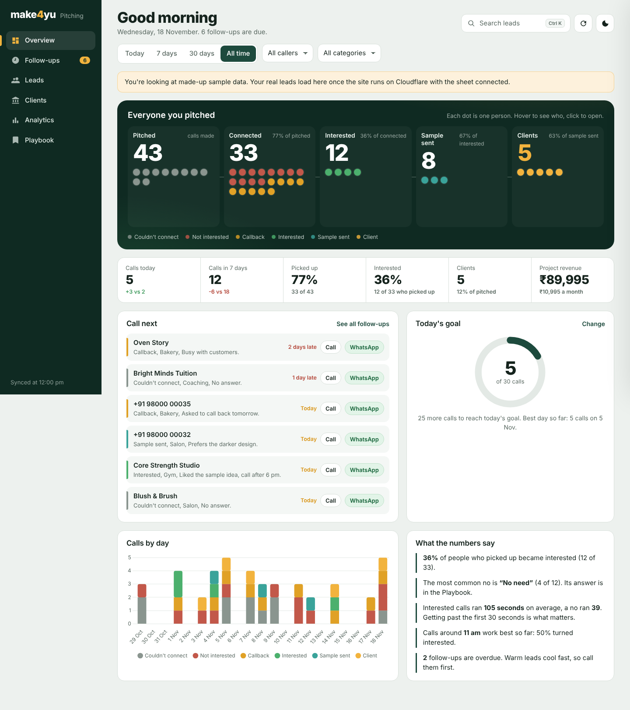

# make4yu Pitching

A private sales dashboard for [make4yu](https://make4yu.com), the studio that builds websites for
small businesses. Callers log every pitch in a Google Sheet; the dashboard turns it into a live view
of who to call next and whether pitching is improving.



## What's inside
- **Everyone you pitched.** Each person is a dot that flows into their stage, from pitched to client. Hover for the name, click to open.
- **Follow-ups.** Late, today, tomorrow, this week, and people never reached, each with one-tap Call and WhatsApp.
- **Leads.** Table or board, tabs for interested, callbacks, not interested, couldn't connect and clients, sortable, with CSV export.
- **Lead panel.** Full history, recording link, and the exact script to answer that lead's objection.
- **Clients.** Project revenue, monthly care-plan income and a running revenue chart.
- **Analytics.** A weekday-by-hour heatmap of when people say yes, objections, call length against outcome, and results by category and caller.
- **Playbook.** The six-step pitch and objection replies, with how often each objection comes up.
- Daily call goal, Ctrl+K search, dark mode, keyboard shortcuts, works on phones.

## How it's built
- **No framework, no build step.** HTML, CSS and JavaScript in `public/`, Chart.js for charts.
- **Live data without a database.** `functions/api/leads.js`, a Cloudflare Pages Function, signs a
  Google service-account JWT with WebCrypto and reads the sheet through the Sheets API.
- **Private by default.** Every API request must carry a valid Cloudflare Access JWT (signature,
  issuer, audience and expiry are checked). Until Access is configured, the API serves nothing.
- **Automated.** GitHub Actions deploy on every push and back up the sheet nightly to a separate private repo.
- **One-command setup.** `setup.sh` uses the GitHub CLI and the Cloudflare API to push the code,
  store the secrets, create the Access login, deploy, and connect the domain.

## What's public and what isn't
| In this public repo | Kept private |
|---|---|
| All code, styles, workflows and setup | The lead data (Google Sheet) |
| Made-up sample data in `public/demo.json` | Google key, Cloudflare token, Access settings (secrets) |
| | Nightly backups (separate private repo) |

The workflows print counts only, never data, because Action logs on a public repo are public.

## Try it locally
```bash
cd public && python3 -m http.server
```
Open <http://localhost:8000>. With no API it shows the made-up sample data.

## Set it up
See [SETUP.md](SETUP.md). Short version: `./setup.sh`.

## Change the look
Colours and fonts are CSS variables at the top of `public/styles.css`. The main green, `#1D4A3D`,
is make4yu.com's theme colour; marigold `#F2B33D` marks anything that needs attention.
